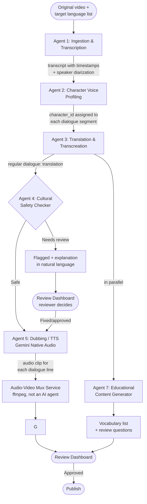

# Agent Pipeline — detail for each agent

This is the core piece that drives "Technical Merit & Meaningful Gen AI" for the
project — each agent has a clear input/output, uses Gemini for exactly what it's
strongest at, not just a single bare API call.

## Full Flowchart

**Script-first alternative to Agent 1** (specs/003-script-first-ingestion): a job
can also start directly from a locked text script (CSV: `segment_code,
character_name, text`) instead of a video — so translation/dubbing can run in
parallel with the video editor's work, instead of waiting for a finished video
(see `docs/manual-dubbing-process.docx`'s own "English Renvoice is the duration
benchmark" rule, which this mirrors). In that case `ScriptBenchmarkAgent`
occupies Agent 1's stage slot instead of `IngestionAgent` (see "Agent 1
(script-first variant)" below) — `worker/pipeline.py::Pipeline.run()` picks
between the two **at run time**, based on whether `context.source_video_gcs_uri`
is set, not at construction time like every other stage. Every stage after that
point (Agent 2 onward) runs identically either way. The Audio-Video Mux Service
step is **conditional**: it's skipped entirely for a script-first job (nothing
to mux yet) — the job instead goes straight to Review with a downloadable set of
dubbed audio files (`GET /jobs/{id}/dubbed-audio-bundle`, FR-008). A real video
can be linked onto the job later via `POST /jobs/{id}/attach-video` (US5), which
runs ONLY the mux step directly (reusing the already-dubbed audio from every
earlier stage) — it does not re-run translation/safety/dubbing.

## Detail for each agent

### Agent 1 — Ingestion & Transcription Agent
- **Input**: the original video file (GCS URI)
- **Processing**: extracts the audio track, calls Gemini (multimodal audio) to
  produce a timestamped transcript + automatically determine how many distinct
  speakers there are (speaker diarization)
- **Output**: `dialogue_lines[]` — each line has `start_time`, `end_time`, `speaker_tag`,
  `original_text`
- **Why this needs to be its own agent, not merged with translation**: transcript
  quality directly affects every step downstream; kept separate so the transcript
  can be reviewed/fixed before spending money on incorrect translation + dubbing

### Agent 1 (script-first variant) — English Timing Benchmark Agent
(`ScriptBenchmarkAgent`, specs/003-script-first-ingestion)
- **Input**: `dialogue_lines[]` with `original_text` only — a script-first job
  has no real recording yet, so there is no video/audio for Gemini to
  transcribe from in the first place (the lines instead come from the
  uploaded script at job-creation time, already carrying `segment_code` and a
  manually-assigned `character_id`)
- **Processing**: for each line, calls **Gemini Native Audio** (the same TTS
  call `DubbingAgent` uses for the real dub) to generate a throwaway English
  voiceover, purely to measure its real spoken duration — standing in for
  "the real video's measured audio" that `IngestionAgent` would normally
  provide. Deliberately uses the real TTS engine rather than a
  words-per-minute heuristic, since the benchmark needs to predict the pacing
  of the SAME engine that will produce the real dub later. The generated
  audio itself is immediately discarded — never uploaded, never shown to
  anyone
- **Output**: real `start_time`/`end_time` per line, laid out cumulatively —
  the exact same shape Agent 1's normal output has, so Agent 2 onward
  consumes it identically either way
- **Known limitation, accepted for this version**: unlike a video-first job's
  benchmark (real human speech, reviewed by a human before publishing per
  Principle #5), this benchmark is never reviewed — if the TTS model
  occasionally mis-paces a line, the resulting duration is a rougher proxy
  than real footage would give. `mux_service.py`'s existing atempo clamp
  still absorbs the resulting mismatch the same way it already does for a
  video-first job's own per-line timing errors

### Agent 2 — Character Voice Profiling Agent
- **For a script-first job** (specs/003-script-first-ingestion): this agent
  requires no code branch at all — it's already a safe no-op. A script-first
  line never gets a `speaker_tag` (only transcription produces one), so the
  "any new speaker_tag found?" check that triggers downloading a video sample
  is naturally never entered; the character's voice was already assigned
  manually at script-import time (see `PUT /characters/{id}/voice`)
- **Input**: `dialogue_lines[]` with `speaker_tag`, plus a sample audio clip for
  each speaker
- **Processing**: Gemini analyzes voice characteristics (pitch, pace, speaking
  style) → assigns a consistent `character_id`; for a multi-episode series,
  cross-references the `character_voice_profiles` saved from previous episodes to
  **keep the character's voice consistent throughout**
- **Choosing the TTS voice for the character** (`build_voice_profile_metadata`,
  shared with the flow where the user manually uploads a voice sample in the
  Character Voice Manager) — 3 fallback tiers, a failure at any tier must not
  fail the whole job:
  1. **Voice Design** (`client.voices.create`, type="prompted"): Gemini listens
     to the sample and describes the voice characteristics in English, then
     uses that description to synthesize an ENTIRELY NEW TTS voice closely
     matching the original — not limited to a fixed voice set. Does not need
     consent_audio (unlike Voice Replication — cloning exactly one real
     person's voice, which isn't feasible with an existing video's voice
     actor). Google itself blocks it (for safety) if the description sounds
     like a child's/minor's voice — the system **deliberately accepts** this
     (not trying to work around Google's safety policy), falling through to
     tier 2.
  2. If tier 1 fails → pick from Gemini's 12 built-in prebuilt TTS voices
     (listen to the sample, choose the closest match by gender/pitch/style) —
     the older approach, still usable for any age group.
  3. If both tiers above fail → fall back to `hash(character_id)` (guarantees
     the same character always gets the same voice, though not guaranteed to
     sound like the original).
- **Output**: a `speaker_tag → character_id` mapping + `voice_profile_metadata`
  (the chosen TTS voice), updates the `characters` table
- **This is the core differentiator versus a typical dubbing tool** (which has
  no concept of a "character", just a generic voice-over translation)

### Agent 3 — Translation & Localization Agent
- **Input**: `dialogue_lines[]`, the target language
- **Processing**:
  - Translates dialogue while keeping a tone, humor, and conversational cadence
    appropriate for children in the target market (Gemini text model)
  - Adapts cultural idioms and child-friendly expressions contextually rather
    than translating literally
- **Output**: `translated_text` for each line, for each target language

### Agent 4 — Cultural Safety Checker Agent
- **Input**: `translated_text`, the target language/market, `cultural_safety_rules`
  (a DB table — country-specific rules, extensible)
- **Processing**: Gemini reads each translated line, cross-references it against
  the target market's cultural context, and assesses for itself whether there's
  anything inappropriate for children/culturally sensitive in that market
  (e.g.: food imagery, religious symbols, a joke that could be misread)
- **Output**: `safety_status` (`ok` / `flagged`) + `reasoning` (a natural-language
  explanation of why it was flagged) for each line
- **Does not automatically block anything** — only flags + explains, the final
  decision is made by the reviewer (see Principle #5 in AGENTS.md / GEMINI.md)

### Agent 5 — Dubbing / TTS Agent
- **Input**: the approved `translated_text`, `character_id` (to fetch the right
  voice profile), the original `start_time`/`end_time` (to fit the timing)
- **Processing**: calls **Gemini Native Audio** to generate audio that keeps
  intonation/emotion close to the original; automatically time-stretches or
  requests regeneration with rate constraints if the generated audio drifts
  beyond the original timestamp boundary
- **Output**: an audio clip (GCS URI) for each dialogue line

### Audio-Video Mux Service (not an AI agent)
- Uses `ffmpeg` to mux the generated audio clips into the original video at the
  correct timestamps, keeping the picture/background music unchanged, only
  replacing the dialogue track
- **Conditional for a script-first job** (specs/003-script-first-ingestion):
  there's no video yet to mux into, so this stage is skipped entirely —
  `worker/pipeline.py::Pipeline.run()` omits `("muxed", None)` from its stage
  list whenever `context.source_video_gcs_uri is None`, and the job goes
  straight to `ready_for_review` with a downloadable dubbed-audio bundle
  instead. When a real video is attached later (`POST
  /jobs/{id}/attach-video`), the worker runs ONLY this mux step directly
  (`Pipeline._run_mux_stage`) against the already-dubbed audio — it does not
  re-enter the pipeline from the top.

### Agent 7 — Educational Content Generator Agent (runs in parallel, not on the critical path)
- **Input**: `translated_text` for the whole episode, the target language
- **Processing**: Gemini selects 8-12 vocabulary words appropriate for a child's
  level, generates flashcards (word + meaning + example sentence), generates
  3-5 simple review questions
- **Output**: `vocabulary_items[]`, shown in the dashboard for parents/teachers
- **Scoring value**: boosts "Impact" (language education) without significant
  extra development time since it reuses the already-integrated Gemini text
  model

## Input/output summary table for easy reference while coding

| Agent | Main Input | Main Output | Gemini Model Used |
|---|---|---|---|
| 1. Ingestion & Transcription | video (audio track) | dialogue_lines + timestamps | Gemini multimodal (audio understanding) |
| 1 (script-first variant). Timing Benchmark | dialogue_lines (text only, no video) | dialogue_lines + real timestamps | Gemini Native Audio (TTS, discarded) |
| 2. Voice Profiling | dialogue_lines + sample audio | character_id mapping | Gemini multimodal (audio) |
| 3. Translation & Localization | dialogue_lines + target_lang | translated_text | Gemini text (contextual translation) |
| 4. Cultural Safety | translated_text + safety_rules | safety_status + reasoning | Gemini text (reasoning) |
| 5. Dubbing/TTS | translated_text (approved) + character voice | audio clip | Gemini Native Audio |
| 7. Educational Content | translated_text (whole episode) | vocabulary + quiz | Gemini text |

## Per-agent latency

`Pipeline.run()` (`backend/worker/pipeline.py`) times each stage's
`agent.run()` call (and the mux step) with `time.perf_counter()`, logs it,
and returns a `stage_durations: dict[str, float]` (seconds) alongside the
usual `(context, educational_result)` — excludes checkpoint/Firestore
writes, so it reflects pure per-agent processing time. Run
`python -m scripts.benchmark_pipeline <job_id>` (`backend/scripts/
benchmark_pipeline.py`) against a real job to print a latency breakdown and
append it to `benchmark_results.jsonl` for comparing across runs.
