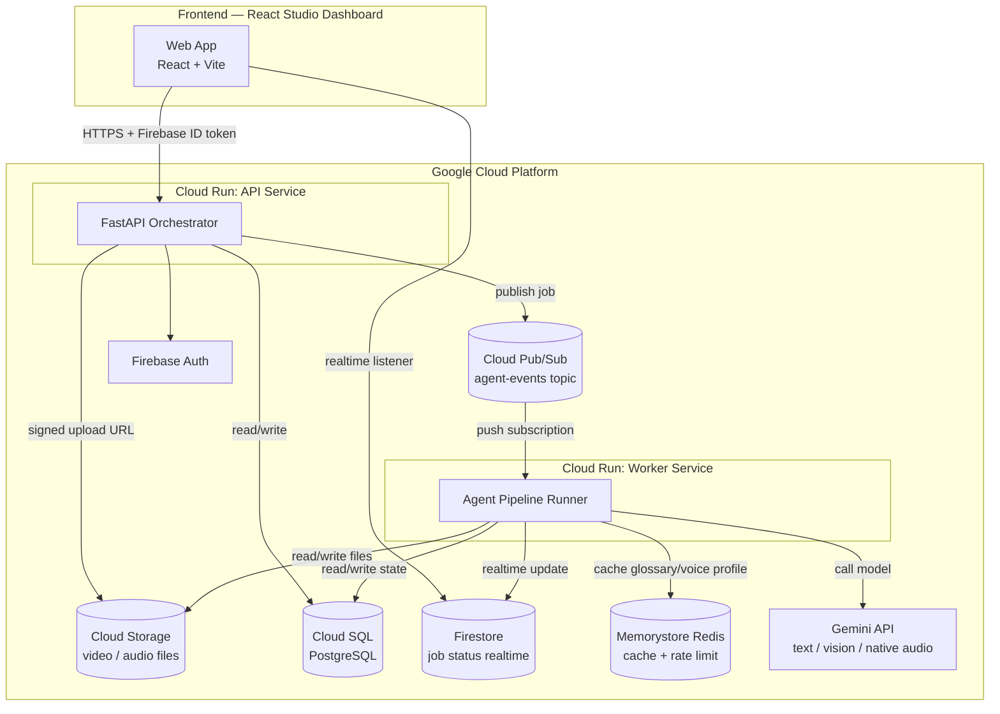
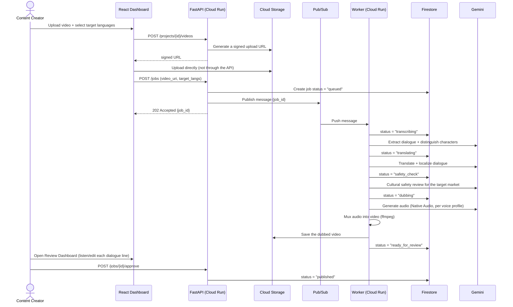
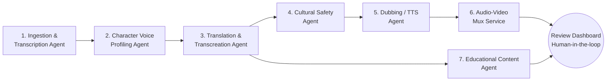
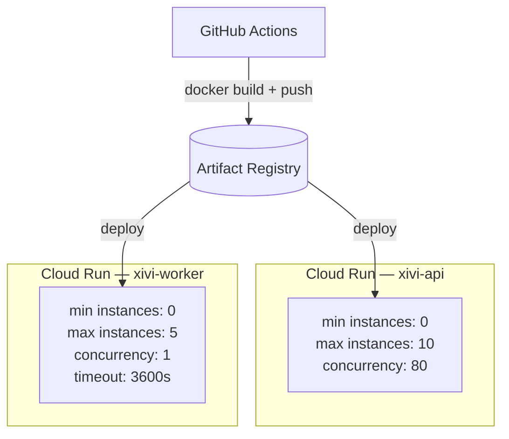

# System Architecture — XIVI Agent

## 1. Overall system diagram

**Why 2 separate Cloud Run services (api vs worker)?**
- `api`: serves HTTP requests from the frontend, needs to respond fast (<1s),
  scales with user traffic
- `worker`: handles the long-running pipeline (translation, dubbing, audio
  muxing — can take several minutes per video), receives work via a Pub/Sub
  push subscription, scales with job volume, and never has a user directly
  waiting on an HTTP request to it

Keeping them separate gives us: (1) users don't time out while uploading
video, (2) the two very different kinds of load can scale independently,
(3) it follows GCP's recommended serverless pattern for long-running tasks.

## 2. Main data flow (request lifecycle)

## 3. Agent architecture (details in `agent-pipeline.md`)

## 4. Deployment view

- `worker` is set to **concurrency: 1** because each job uses a lot of CPU/memory
  for audio/video processing (shouldn't process multiple jobs in parallel on
  the same instance)
- `timeout: 3600s` because Cloud Run supports up to 60 minutes/request — enough
  for a ~10-20 minute video (children's animated content is usually short, not
  a 1-hour video)

## 5. Key technical risks to watch for when building

| Risk | Mitigation |
|---|---|
| Cloud Run timeout on long videos | Split the video into scenes/chunks, process each chunk in parallel in the worker, stitch them back together at the end |
| Gemini Native Audio API may be rate-limited | Cache results by `(dialogue_line_id, target_lang, voice_profile_id)` in Redis, avoiding repeat calls on retry |
| Audio/video sync after dubbing | Keep the original timestamps from the transcription step, align the new audio to those timestamps instead of concatenating sequentially |
| Losing state if the worker crashes mid-run | Save a checkpoint after each agent step to the `jobs.current_stage` column in Postgres, the worker resumes from the last stage instead of starting over |
