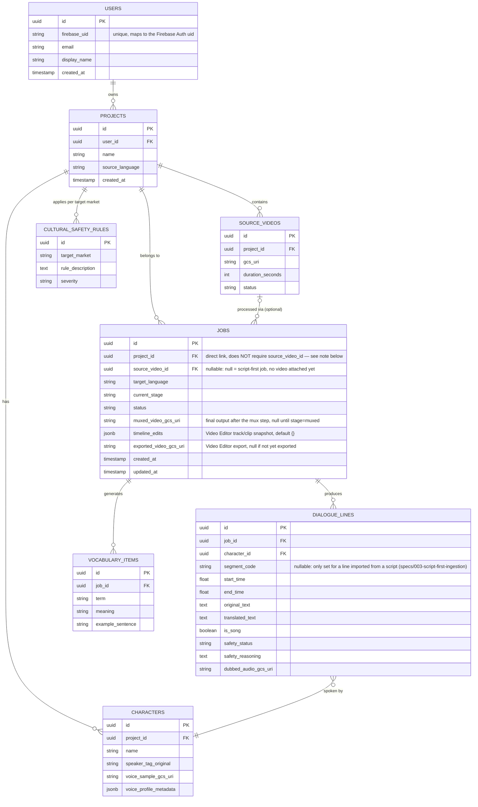

# Database Schema — Cloud SQL (PostgreSQL) + Firestore

## 1. Why use both kinds of database

| | PostgreSQL (Cloud SQL) | Firestore |
|---|---|---|
| Used for | Structured, clearly relational data (project, job, dialogue lines, character) | Real-time job status pushed to the UI |
| Why chosen | Complex queries (joins, filtering on multiple conditions), transactions when updating several tables at once | Native realtime listener, the frontend doesn't need to write its own WebSocket |
| Who writes | Both the API service and the Worker service | Only the Worker writes, the Frontend only reads (listener) |

Principle: **Postgres is the source of truth**, Firestore is just a "current
state" copy so the UI updates quickly — if Firestore ever gets out of sync, it
can always be rebuilt from Postgres.

## 2. ERD



## 3. Important design notes

- **`jobs.project_id` / `jobs.source_video_id`** (specs/003-script-first-ingestion):
  a job used to only reach its `Project` by joining through
  `source_video_id → source_videos.project_id`. A **script-first job** (started
  directly from an uploaded text script, see US1 in that spec, instead of
  requiring an already-recorded video) has no video at all yet, so `jobs` now
  has a **direct** `project_id` FK, and `source_video_id` was changed from
  `NOT NULL` to **nullable** — `NULL` means "script-first job, no video
  attached yet" (set later via `POST /jobs/{id}/attach-video`), not a separate
  boolean column (per `AGENTS.md`'s "don't hardcode what can be derived" —
  `source_video_id IS NULL` is the single source of truth other code branches
  on, e.g. `approve_job`, the mux pipeline stage). Migrated via a 3-step
  nullable→backfill→`NOT NULL` sequence (same pattern already used for
  `jobs.timeline_edits`, see the migration file itself) since `project_id`
  couldn't be added as `NOT NULL` directly to a table with existing rows.
- **`dialogue_lines.segment_code`** (specs/003-script-first-ingestion):
  only set for a line imported from a script-first job's uploaded script
  (`segment_code,character_name,text` CSV) — `NULL` for a line produced by
  transcription (IngestionAgent has no equivalent identifier). Lets a human
  editor match an exported dubbed-audio file (`GET
  /jobs/{id}/dubbed-audio-bundle`) back to its row in the original script.
- **`jobs.current_stage`** is the column used for checkpoint/resume (see
  `backend-spec.md` section 2) — if the worker crashes mid-run it resumes from
  the right place instead of starting over, avoiding re-paying for the Gemini
  calls on steps that already finished
- **`characters.voice_profile_metadata`** (type `jsonb`) stores the voice
  characteristics analyzed by Agent 2 (pitch, pace...) — uses `jsonb` because
  the structure may change as the algorithm improves, with no need to migrate
  the schema each time
- **`jobs.timeline_edits`** (type `jsonb`, see `specs/002-video-editor/spec.md`
  Clarifications #1): stores the entire current track/clip snapshot of the
  Video Editor instead of being split into separate relational tables
  `timelines`/`tracks`/`clips` — simpler for the MVP, still sufficient for
  autosave/undo-redo since only the final snapshot needs to survive a reload,
  with no need to persist edit history to the DB.
  `jobs.exported_video_gcs_uri` is kept separate from `muxed_video_gcs_uri` so
  the original AI version is never overwritten when the creator exports a new
  edit.
- **`cultural_safety_rules`** is a separate table instead of being hardcoded in
  code (per Principle #6 in `AGENTS.md` / `GEMINI.md`) — allows adding rules for a new
  country (e.g. Indonesia, Philippines) without redeploying code, just by
  inserting data
- **`dialogue_lines.is_song`**: a flag used by `TranslationAgent` to choose the
  transcreation prompt instead of a normal translation — can be set manually
  while reviewing the initial transcript (simpler than automatic detection,
  appropriate for the 3-week scope)

## 4. Important indexes to create

Already declared via `Index()`/`index=True` in `backend/api/db/models.py`,
generated as part of the `init schema` migration — no need to create them by hand:

```sql
CREATE INDEX idx_dialogue_lines_job_id ON dialogue_lines(job_id);
CREATE INDEX idx_dialogue_lines_safety_status ON dialogue_lines(job_id, safety_status);
CREATE INDEX idx_jobs_source_video ON jobs(source_video_id);
CREATE INDEX idx_jobs_project ON jobs(project_id);
CREATE INDEX idx_characters_project ON characters(project_id);
```

`idx_dialogue_lines_safety_status` directly serves the Review Dashboard screen
(quickly filtering `flagged` lines for the reviewer to handle first).
