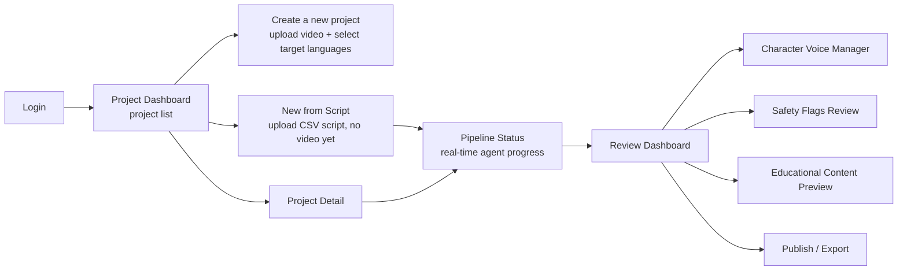

# Frontend Spec — React Studio Dashboard

## 1. Tech stack

| Category | Choice | Reason |
|---|---|---|
| Framework | React 18 + Vite + TypeScript | Fast builds, no SSR needed (this is an internal dashboard, no SEO needed) |
| Styling | TailwindCSS + shadcn/ui | Fast UI development for a hackathon, components ready out of the box (dialog, table, tabs) |
| Data fetching | TanStack Query | Caching, auto-refetch, clean handling of loading/error state for API calls |
| Global state | Zustand | Lighter than Redux, enough for the project's scope (user session, current project) |
| Realtime | Firebase JS SDK (Firestore listener) | Receives job status updates directly, no need to write a WebSocket server |
| Audio/Video player | `wavesurfer.js` + a standard `<video>` tag | Shows the waveform when reviewing each dialogue line — important for review UX |
| Auth | Firebase Authentication (Google Sign-In) | Fast login for the demo, integrates natively with Firestore rules |
| Form | React Hook Form + Zod | Validates input (language selection, upload metadata) |

## 2. Page flow diagram



## 3. Detail for each screen

### 3.1 Project Dashboard
- List of projects as cards: name, video thumbnail, number of target languages,
  overall status (processing / needs review / published)
- "Create new project" button

### 3.2 New Project — Upload
- Form: project name, video upload (using a signed URL from the backend,
  uploading directly to GCS — **not** pushing the file through the backend, to
  avoid timeouts/wasted bandwidth)
- Multi-select target languages (checkboxes by country flag, grouped by JAPAC
  region)
- After submitting → calls `POST /jobs` → navigates to Pipeline Status

### 3.2b New Project from Script — Upload (specs/003-script-first-ingestion)
- Route: `/projects/new-script` (`NewScriptProject.tsx`) — a sibling of 3.2's
  `/projects/new`, for when the editor hasn't finished cutting the video yet
  and translation/dubbing should start in parallel instead of waiting (US1;
  mirrors `docs/manual-dubbing-process.docx`'s own parallel-execution
  workflow)
- Form: project name, upload a CSV script instead of a video (format
  documented in `docs/backend-spec.md` section 6, sample at
  `docs/sample-script-import.csv`) — parsed client-side first so parsing
  errors (bad header, ragged row, duplicate `segment_code`) surface
  immediately instead of after a round-trip to the backend
- Once parsed, every distinct `character_name` found in the script must be
  assigned a voice via `VoicePicker` (one of the 12 prebuilt TTS voices, `GET
  /characters/voice-options`) — there is no audio sample for
  `VoiceProfilingAgent` to listen to yet, so this step replaces it (US2)
- Multi-select target languages (same component as 3.2)
- After submitting → calls `POST /projects/{id}/script-jobs` → navigates to
  Pipeline Status, same as a video-first job. The resulting job has no video
  attached (`source_video_id = null`) until later (see 3.4's audio-only
  variant and `POST /jobs/{id}/attach-video`)

### 3.2c Add Video to an existing project
- Route: `/projects/:projectId/new-video` — reuses the same `NewProject.tsx`
  component as 3.2, just with a `projectId` route param. Linked from
  `ProjectDetail.tsx`'s "New Video" button (real bug found via feedback:
  that button used to point at plain `/projects/new`, so clicking it from
  inside an existing project actually created a brand new, unrelated
  project instead of adding a video to the one being viewed)
- Form: identical to 3.2 minus the Project Name / Source Video Language
  fields — those only make sense once, at project creation, and are reused
  as-is from the existing project. Card title reads "Add Video — {project
  name}" instead of "New Project"
- After submitting → skips `POST /projects` entirely, goes straight to the
  existing project's `POST /projects/{id}/upload-url` → `POST /jobs` →
  navigates to Pipeline Status, same as 3.2 from that point on

### 3.3 Pipeline Status (the "wow" screen during the demo)
- A stepper showing the 6 agents in order, the currently-running agent has an
  animation, completed agents show a checkmark
- Data comes via a Firestore realtime listener (no REST polling) — updates
  instantly whenever the worker changes `status`
- This screen should be **demoed live on stage** since it clearly shows the
  multi-step agentic nature, not just "1 API call returning an instant result"

### 3.4 Review Dashboard
- A table of `dialogue_lines`, each row containing:
  - Original text / translated text (editable)
  - A play button for the dubbed audio (waveform)
  - A safety status badge (green: ok, yellow: flagged with a tooltip showing
    Agent 4's reasoning)
  - Allows editing the text → triggers a re-dub for just that line (without
    re-running the whole pipeline)
- Synced video preview: clicking a row → the video jumps to the corresponding
  timestamp
- **Audio-only variant, for a script-first job with no video yet**
  (specs/003-script-first-ingestion, US4/US5): the dialogue-line table,
  editing, and re-dub flow all work identically with no video — only the
  synced video preview and the Video Editor are unavailable. In its place:
  - A "Download dubbed audio" action (`GET /jobs/{id}/dubbed-audio-bundle`,
    FR-008) — a zip of every dubbed line's audio, named by `segment_code`,
    for the editor to use while cutting the real video. This is the
    deliverable before a video exists; "Approve & Publish" also works on
    this audio-only state (an audio-only `approve_job` branch)
  - An "Attach video" action, shown once the editor has a finished cut
    (`canAttachVideo`: no video successfully muxed yet, and
    `current_stage === "ready_for_review"`) — uploads the file then calls
    `POST /jobs/{id}/attach-video`, which runs only the mux step against the
    already-dubbed audio. On success, the table transitions in place to the
    normal video-synced view with zero manual reload (`useJob`'s own
    `refetchInterval`, gated on `current_stage === "muxing"`, detects
    completion). On a mux failure (e.g. a corrupt upload), an
    `AlertTriangle` banner explains what happened and the same "Attach
    video" action reappears for a retry — distinguishing "has a video ever
    been attached" (`hasVideo`, used only to mirror the backend's
    `approve_job` branching) from "has a video successfully finished muxing"
    (`hasMuxedVideo`, used for the preview/editor/share actions) is
    important here: `current_stage` alone resets to `"ready_for_review"` on
    both success and failure, so it cannot tell the two apart

### 3.5 Character Voice Manager
- List of detected characters, for each character: name (set manually),
  original voice sample, dubbed voice sample, lets you listen and request a
  re-dub if the voice isn't satisfactory

### 3.6 Educational Content Preview
- List of vocabulary flashcards + review questions generated by Agent 7, lets
  you show/hide each item before publishing it along with the video

### 3.7 Publish / Export
- A "Publish" button — calls `POST /jobs/{id}/approve`
- Shows a link to the dubbed video (a public or signed GCS URL), a button to
  download the learning materials (a PDF/JSON vocabulary list)

## 4. Proposed directory structure

```
frontend/
├── src/
│   ├── pages/
│   │   ├── Login.tsx
│   │   ├── Dashboard.tsx
│   │   ├── NewProject.tsx
│   │   ├── PipelineStatus.tsx
│   │   ├── ReviewDashboard.tsx
│   │   ├── VoiceManager.tsx
│   │   └── Publish.tsx
│   ├── components/
│   │   ├── ui/                 # shadcn components
│   │   ├── AudioPlayer.tsx
│   │   ├── VideoPlayer.tsx
│   │   ├── PipelineStepper.tsx
│   │   └── SafetyBadge.tsx
│   ├── hooks/
│   │   ├── useProjects.ts       # TanStack Query hooks
│   │   ├── useJobStatus.ts      # Firestore realtime listener
│   │   └── useAuth.ts
│   ├── stores/
│   │   └── sessionStore.ts      # Zustand
│   ├── lib/
│   │   ├── api.ts               # fetch wrapper calling the backend
│   │   └── firebase.ts
│   └── App.tsx
└── vite.config.ts
```

## 5. Key UX principles (affecting the "UX & Solution Design" score)

- Never leave the screen "blank and waiting" for more than 2-3 seconds with no
  feedback — every long-running action (upload, processing) must have a clear
  progress indicator
- A safety flag must show its **reasoning in natural language**, not just a
  warning icon — this is what showcases the Gen AI's "reasoning", so it should
  be leveraged to make a stronger impression during the demo
- The Review Dashboard should allow fast editing/approval (keyboard shortcut:
  `A` = approve the current line, `→` = next line) — if there's time, this is
  a small detail that still shows serious product thinking
